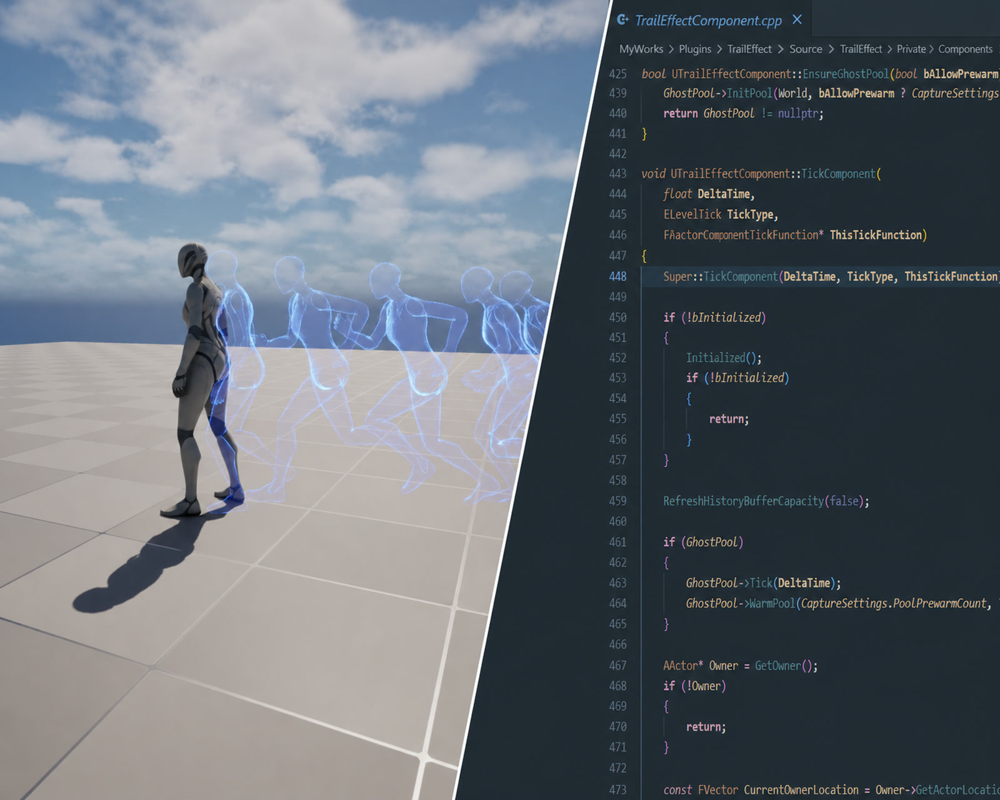
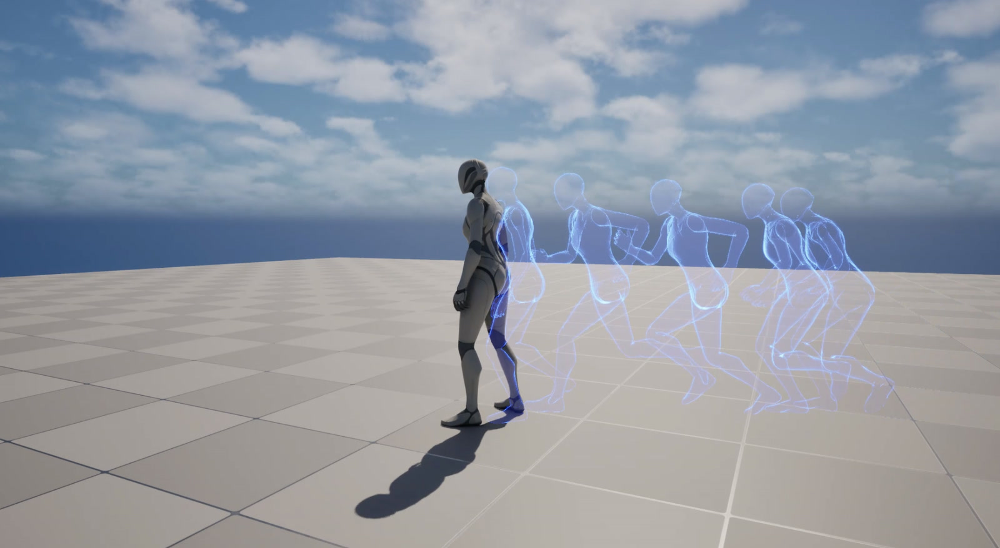
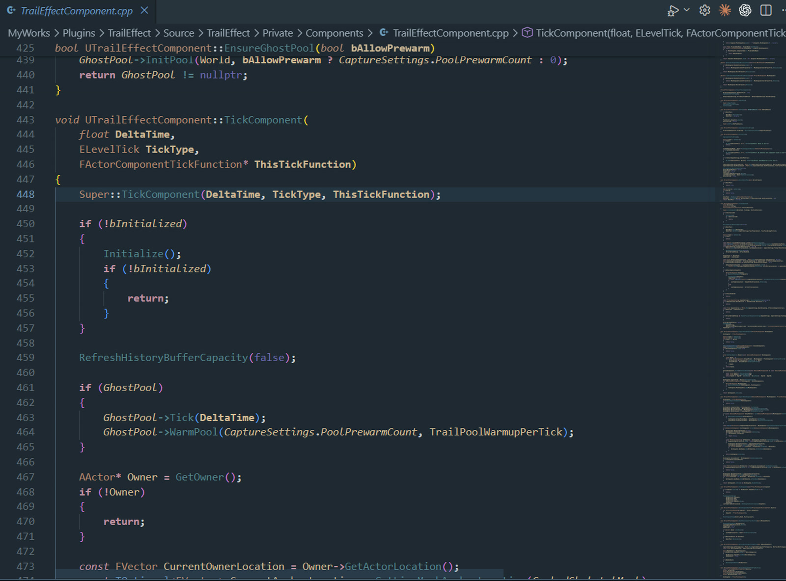

> 样稿。正文只整理自档案条目里已有的文字和代码，没有补充经历。条目年份是「当前」，具体日期未记录；文首日期只用于排序。

技术美术 / C++

## 项目概述

一个可复用的 Unreal Engine 角色残影组件，通过记录运动历史生成清晰、可控的实时残影。

<figure>
  
  <figcaption>trail-effect-cover.jpg</figcaption>
</figure>

<video controls playsinline preload="metadata" poster="/assets/traileffect/trail-effect-cover.jpg" aria-label="Trail Effect 在 Unreal Engine 中生成角色实时残影的演示。">
  <source src="/assets/traileffect/trail-effect-demo.mp4" type="video/mp4" />
</video>

## 我的职责

技术美术 / C++

## 设计要点

- 支持连续残影、一次性 Burst 与动画 Notify 驱动的生成方式。
- 固定容量历史缓冲控制运行时内存，并支持按目标时间获取姿态。
- 对象池限制每个 Session 的激活数量，过期 Ghost 会回收到 FreeList。

## 从采样到残影复用

### 姿态采样

按时间间隔或位移阈值捕获角色姿态；检测到传送距离时重置历史，避免残影跨场景拉伸。

### 历史缓冲

使用固定容量环形缓冲保存姿态快照，并根据残影目标时间查找相邻帧进行插值。

### 生成与回收

Ghost Actor 从对象池获取，生命周期结束后回收；材质参数随时间更新透明度与视觉变化。

## 采样、缓冲与对象池

### 按时间与位移触发采样

`Private/Components/TrailEffectComponent.cpp`

```cpp
// 累计采样与生成计时
SampleTimer += DeltaTime;
SpawnTimer += DeltaTime;

const float EffectiveSampleInterval = FMath::Max(CaptureSettings.SampleInterval, 0.01f);
bool bShouldCaptureSnapshot = bTrailWarmupPending || SampleTimer >= EffectiveSampleInterval;

// 时间未到时，位移超过阈值也会触发采样
if (!bShouldCaptureSnapshot && CaptureSettings.MinDistanceForSample > 0.f)
{
    bShouldCaptureSnapshot = !LastCapturedAnchorLocation.IsSet() ||
        FVector::Dist(LastCapturedAnchorLocation.GetValue(), CurrentTrailLocation) >= CaptureSettings.MinDistanceForSample;
}

// 捕获成功后写入历史缓冲
if (bShouldCaptureSnapshot)
{
    FTrailPoseSnapshot Snapshot;
    if (CapturePoseSnapshot(Snapshot))
    {
        PushSnapshot(Snapshot);
        SampleTimer = 0.f;
    }
}
```

### 固定容量环形缓冲

`Private/Components/TrailEffectComponent.cpp`

```cpp
void PushSnapshotToRing(
    TArray<FTrailPoseSnapshot>& Buffer,
    int32& BufferHead,
    int32& BufferCount,
    int32 Capacity,
    const FTrailPoseSnapshot& Snapshot)
{
    if (Capacity <= 0)
    {
        return;
    }

    // 循环覆盖最旧数据，避免历史记录持续增长
    Buffer[BufferHead] = Snapshot;
    BufferHead = (BufferHead + 1) % Capacity;
    BufferCount = FMath::Min(BufferCount + 1, Capacity);
}
```

### Ghost 对象池复用

`Private/Ghost/TrailGhostPool.cpp`

```cpp
ATrailGhostActor* UTrailGhostPool::Acquire(int32 MaxActiveGhostCount, uint64 OwnerSessionId)
{
    // 每个会话都受最大激活数量限制
    if (MaxActiveGhostCount > 0 && GetActiveGhostCountForSession(OwnerSessionId) >= MaxActiveGhostCount)
    {
        return nullptr;
    }

    // 优先复用空闲对象，没有可用对象时再创建
    ATrailGhostActor* Ghost = nullptr;
    if (FreeList.Num() > 0)
    {
        Ghost = FreeList.Pop().Get();
    }
    else
    {
        Ghost = SpawnGhost();
    }

    if (Ghost)
    {
        ActiveList.Add(Ghost);
    }

    return Ghost;
}

void UTrailGhostPool::Release(ATrailGhostActor* Ghost)
{
    if (!Ghost)
    {
        return;
    }

    // 失活后从活动列表回收到空闲列表
    Ghost->DeactivateGhost();
    ActiveList.Remove(Ghost);
    FreeList.Add(Ghost);
}
```

<figure>
  
  <figcaption>档案图片 trail-effect-engine.jpg</figcaption>
</figure>

<figure>
  
  <figcaption>档案图片 trail-effect-code.jpg</figcaption>
</figure>

同一条目仍在[作品档案](/works/)里。
